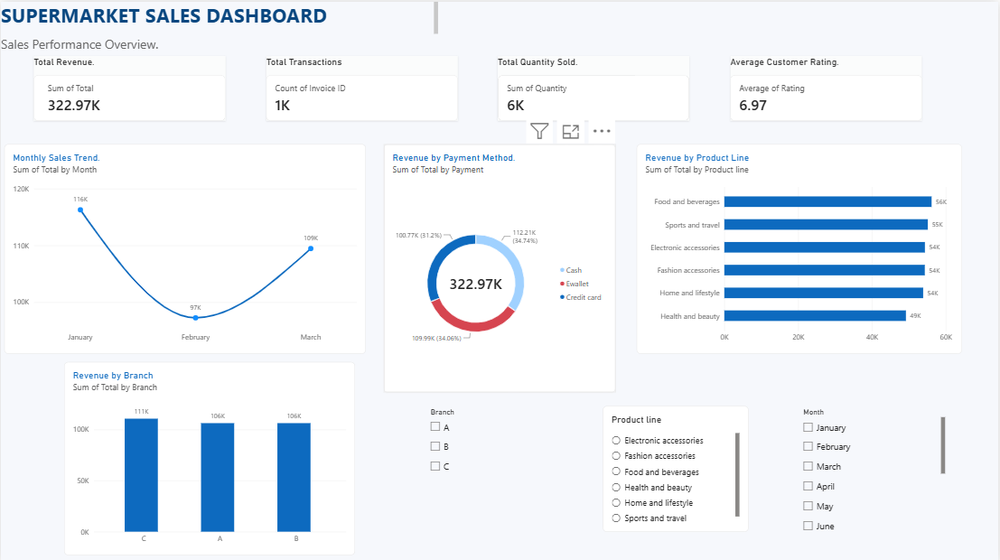

# Supermarket-Sales-Analysis-PowerBI
Interactive supermarket sales analysis dashboard built using Microsoft Power BI.
# Supermarket Sales Analysis Dashboard – Power BI

## Project Overview
This project focuses on analysing supermarket sales data and presenting key business insights through an interactive dashboard developed using Microsoft Power BI.

## Tools Used
- Microsoft Power BI
- Excel
- Supermarket Sales Dataset

## Dashboard Features
- Total Revenue
- Total Transactions
- Total Quantity Sold
- Average Customer Rating
- Monthly Sales Trend
- Revenue by Product Line
- Revenue by Branch
- Revenue by Payment Method

## Interactive Features
The dashboard includes slicers for:
- Branch
- Product Line
- Month

These allow users to explore sales performance from different perspectives.

## Dashboard Preview

## Project Objective
To present supermarket sales information in a clear and interactive way, making it easier to explore sales performance and identify useful business patterns.
